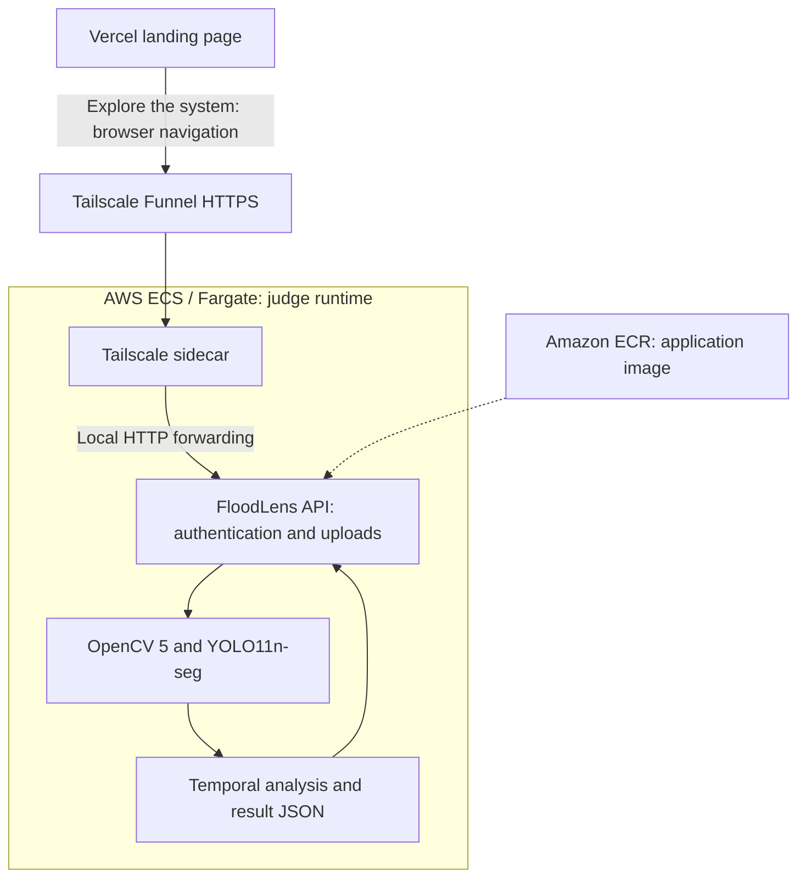

# FloodLens AI

> Research prototype for potential urban flooding in uploaded images and prerecorded videos, using OpenCV 5, YOLO11 segmentation, temporal analysis, and AWS.

## Overview

FloodLens AI is an experimental computer vision project designed to identify urban flooding from images and videos.

The project uses the official YOLO11n-seg MultiDomain model to predict potential flood regions, OpenCV 5 for media processing, a temporal rule that can reject isolated detections, an experimental heuristic risk engine, and a FastAPI backend packaged with Docker. It accepts uploaded images and prerecorded videos; live camera ingestion is not implemented.

Prepared for the OpenCV AI Competition 2026. This repository is not evidence that a final submission has been sent.

- [Project landing page](https://floodlens-ai-vert.vercel.app)
- [Authenticated judge demo](https://floodlens-judge.tail1bb8f1.ts.net/) — use the **Explore the system** button on the landing page. Credentials are supplied privately.
- [Review candidate: PR #4](https://github.com/joa0lucassi/floodlens-ai/pull/4), currently a draft; it has not been merged into `main`.

**Judge-route status:** the complete Vercel → Tailscale Funnel → AWS ECS/Fargate → FloodLens API flow was validated end-to-end on 2026-10-17, including external HTTPS, Basic Auth and real model inference. The ECS service was then intentionally scaled to Desired=0, Running=0, Pending=0 to stop continuous Fargate task usage. A later HTTP 502 while the backend is stopped is therefore expected and does not invalidate the earlier successful validation. The route must be reactivated and rechecked before the judge window. See [judge access and deployment evidence](docs/judge_access_plan.md).

> **Important:** FloodLens AI is an experimental system and is not intended for operational emergency decision-making in its current stage.

---

## The Problem

Urban flooding can develop quickly and monitoring large urban areas manually is difficult.

Existing cameras can provide useful visual information, but automatically distinguishing real flooding from visually similar situations is challenging.

Examples include:

- wet pavement;
- reflections;
- heavy rain;
- nighttime lighting;
- vehicle headlights;
- shadows;
- shiny road surfaces.

FloodLens AI explores how computer vision can help automatically detect and monitor these situations.

---

## Research Pipeline

The latest evaluated video pipeline works as follows:

| Stage | Frozen behavior |
| --- | --- |
| Input | Prerecorded video, decoded by OpenCV 5 |
| Sampling | Approximately one full frame per second |
| Segmentation | YOLO11n-seg MultiDomain; confidence 0.25; imgsz 960 |
| Temporal rule | Sliding window of 5 samples; at least 3 positives in a complete window |
| Video verdict | `CONFIRMED` if any complete window meets the rule; otherwise `NOT_CONFIRMED` |
| Short input | `INSUFFICIENT_DATA` when fewer than 5 usable samples are available |

Overlapping windows advance by one sample. A single image produces a visual candidate, not a temporal verdict. `CONFIRMED` means the algorithmic rule was satisfied; it is not physical verification of flooding.

---

## Why Temporal Analysis?

A segmentation model may occasionally produce an isolated false positive.

For example:

```text
DRY
DRY
FLOOD
DRY
DRY
```

Only 1 of the 5 samples is positive, so flooding is not confirmed.

However, temporal filtering cannot solve persistent semantic errors.

If wet pavement is incorrectly classified as flooding across several consecutive frames:

```text
FLOOD
FLOOD
FLOOD
FLOOD
FLOOD
```

the temporal system will also confirm flooding.

This is currently one of the main research challenges of FloodLens AI.

---

## Final Holdout V2

The latest independent evaluation used a frozen configuration before inference.

### Dataset

- 20 previously unseen real-world videos
- 10 flood videos
- 10 dry videos
- 1 frame sampled per second
- full-frame inference
- inference size: 960
- confidence threshold: 0.25
- temporal window: 5
- confirmation threshold: 3/5

No parameter tuning was performed after observing the holdout results.

### Results

| Metric | Result |
|---|---:|
| True Positives | 10 |
| True Negatives | 5 |
| False Positives | 5 |
| False Negatives | 0 |
| Accuracy | **75.00%** |
| Precision | **66.67%** |
| Recall | **100.00%** |
| Specificity | **50.00%** |
| F1-score | **80.00%** |

### Confusion Matrix

| | Predicted Flood | Predicted Dry |
|---|---:|---:|
| Actual Flood | 10 | 0 |
| Actual Dry | 5 | 5 |

All 10 flood videos were detected in this evaluation.

The primary limitation was false positives in difficult negative conditions, especially:

- wet and reflective pavement;
- rain without flooding;
- nighttime reflections;
- visually difficult road scenes.

Full evaluation details are available in:

```text
docs/final_holdout_v2_results.md
```

---

## Current Research Limitation

The main challenge is no longer simply isolated false detections.

The current model can produce **persistent semantic false positives**.

In some negative videos, wet or reflective pavement was classified as flooding across most of the analyzed frames.

This means that temporal consistency alone cannot solve the problem.

Future improvements should focus on making the vision model better distinguish:

```text
real urban flooding
        VS
wet / reflective road surfaces
```

---

## Flooded Area

FloodLens can estimate the percentage of the camera image occupied by regions segmented as flooding.

For example:

```text
Flooded area: 18.4%
```

This represents the **visual proportion of the image segmented as flood**.

It does **not** represent physical water depth.

Estimating water depth in centimeters would require additional calibration or physical sensing.

---

## Risk Engine

FloodLens includes an experimental heuristic risk engine.

It considers:

- average segmented flood area;
- temporal trend;
- model confidence.

The current levels are:

```text
LOW
MODERATE
HIGH
CRITICAL
```

These levels are experimental heuristics and are not calibrated emergency-risk probabilities.

They are intended for research and prototype development.

---

## System Architecture

**Judge journey:** Vercel landing page → Tailscale Funnel HTTPS → AWS ECS/Fargate → FloodLens API.

Vercel serves the project overview and links the browser to the demo. Uploads go directly to the demo origin; Vercel does not execute YOLO or proxy video uploads. In the validated judge deployment, Tailscale and the authenticated API run in the same ECS/Fargate task. HTTPS, Basic Auth, private SSM secret injection and real model inference were exercised successfully on 2026-10-17. Public inbound TCP 8000 was removed while Funnel continued to provide access.



In PR #4's authenticated demo mode, S3 persistence and shared server history/risk endpoints are disabled; browser-session metadata remains available. S3 belongs to an optional research mode and the historical October 13 AWS test. See [architecture and evidence](docs/submission_architecture.md).

The current Tailscale state directory is ephemeral. A full ECS task replacement can therefore require node cleanup or hostname correction before the published judge URL is relied upon again.

---

## Technology Stack

### Computer Vision

- OpenCV 5
- Ultralytics YOLO11-seg
- PyTorch
- NumPy

### Backend

- Python
- FastAPI
- Uvicorn

### Cloud

- AWS ECR
- AWS ECS / Fargate
- Amazon S3 (optional research mode; disabled in authenticated judge mode)
- Vercel (landing page)
- Tailscale Funnel (HTTPS entry point)

### Infrastructure

- Docker

---

## API

The current FastAPI application exposes the following endpoints:

```text
GET  /
GET  /health
GET  /risk/latest
GET  /analyses/history

POST /analyze/image
POST /analyze/video
```

Current API version:

```text
0.7.0
```

The root endpoint serves the FloodLens dashboard. With demo authentication configured, the dashboard and analysis endpoints require authentication; `/health` remains available for checks, and the shared `/risk/latest` and `/analyses/history` endpoints return 403.

---

## Development Status

### Integrated API pipeline

The API now implements the research configuration used in the Final Holdout V2:

```text
Model: MultiDomain YOLO11-seg (best.pt)
Inference size: 960
Confidence threshold: 0.25
Video sampling: 1 frame / second
Temporal window: 5
Confirmation: >= 3 positive samples per complete window
```

Video responses include temporal confirmation status, a time-indexed timeline, and an experimental heuristic risk assessment. Videos with fewer than five usable samples return an insufficient-data status rather than a definitive negative. The heuristic risk score is not a calibrated probability or a measured water depth.

The updated image and video APIs were tested locally and in Docker, then deployed and successfully tested on AWS ECS with S3 persistence on 2026-10-13. The authenticated PR #4 judge runtime was separately validated end-to-end on AWS with Tailscale Funnel, Basic Auth and real inference on 2026-10-17.

The separate V3 hard-negative fine-tuning experiment did not show an improvement on the 20-image development regression set; the original MultiDomain remains the official model. The frozen Final Holdout V2 was not rerun for these integrations. See [AWS end-to-end validation](docs/aws_end_to_end_validation_2026-10-13.md).

---

## Project Structure

```text
floodlens-ai/
|
|-- docs/
|   `-- final_holdout_v2_results.md
|
|-- models/
|   `-- flood_segmentation/
|       `-- best.pt
|
|-- scripts/
|   `-- push_ecr.ps1
|
|-- src/
|   |
|   |-- api/
|   |   `-- main.py
|   |
|   |-- dataset/
|   |
|   |-- evaluation/
|   |   `-- final_holdout_v2_evaluator.py
|   |
|   |-- risk/
|   |   `-- risk_engine.py
|   |
|   |-- storage/
|   |   `-- s3_storage.py
|   |
|   |-- vision/
|   |   |-- inference.py
|   |   `-- video_inference.py
|   |
|   `-- web/
|       `-- index.html
|
|-- Dockerfile
|-- requirements.txt
`-- requirements-prod.txt
```

Large datasets, evaluation videos, model weights, and generated results are intentionally not versioned in the repository.

---

## Competition Submission Materials (2026)

These documents are **preparation drafts**, not confirmation that the project has been submitted:

- [Devpost project narrative (English)](docs/submission_devpost_draft.md)
- [Architecture diagram — OpenCV 5, temporal pipeline, AWS](docs/submission_architecture.md)
- [Technical report draft](docs/competition_technical_report_draft.md)
- [Final Holdout V2 evaluation](docs/final_holdout_v2_results.md)
- [AWS end-to-end smoke test](docs/aws_end_to_end_validation_2026-10-13.md)
- [Clean-clone reproducibility smoke test](docs/clean_clone_smoke_test.md)
- [Dataset/model provenance and rights review](docs/data_provenance_and_model_release.md)

**Pending before final submission:** reactivate and revalidate the judge runtime for the approved access window; finish the video and screenshots; resolve media/model permissions; and check the authenticated submission form. See [release checklist](docs/submission_final_checklist.md), [screenshots](docs/submission_screenshots_checklist.md), and [official requirements review](docs/competition_requirements_2026-10-18.md).

---

## Running Locally

The commands below reproduce the reviewed application runtime. Documentation-only commits after `24ea9a8` do not change application code. Docker is the production runtime reference. Direct production Python dependencies are pinned, but the Docker base tag, apt packages, transitive dependencies and dashboard Chart.js CDN are not fully locked. This is not a bit-for-bit reproducible build.

### 1. Clone the repository

```bash
git clone --branch security/judge-demo-final-review-2026-10-15 https://github.com/joa0lucassi/floodlens-ai.git
cd floodlens-ai
git checkout --detach 24ea9a86cf300c1f268ccc82ef0b98d9f15a8f77
```

### 2. Create a virtual environment

```bash
python -m venv .venv
```

Windows PowerShell:

```powershell
.\.venv\Scripts\Activate.ps1
```

### 3. Install dependencies

```bash
python -m pip install --upgrade pip
pip install -r requirements.txt
```

### 4. Add the model

The trained model weights are not stored in GitHub.

The application expects the model at:

```text
models/flood_segmentation/best.pt
```

To verify that your locally provided checkpoint matches the frozen official
MultiDomain model (SHA-256), run:

```bash
python scripts/verify_official_model.py
```

For a complete clean-clone Docker smoke test (no AWS required), follow
[Clean-clone reproducibility test](docs/clean_clone_smoke_test.md).
A cloned checkout cannot launch the model-dependent API until an authorized
copy of the official weights is placed at the path above. Distribution rights
for the weights are still under review.

### 5. Start the API

```bash
python -m uvicorn src.api.main:app --host 127.0.0.1 --port 8000
```

The dashboard will be available locally on port:

```text
8000
```

---

## Docker

Build the image:

```bash
docker build -t floodlens-api .
```

Run locally:

```bash
docker run --rm -p 127.0.0.1:8000:8000 floodlens-api
```

---

## AWS Deployment

The October 13, 2026 ECS/Fargate smoke test processed a real development video and saved results to S3. It predates PR #4's authenticated, S3-disabled mode and remains useful historical evidence for the optional storage path.

The authenticated judge deployment was separately validated on 2026-10-17. Task definition `floodlens-task:5` ran the FloodLens application and a Tailscale sidecar in the same Fargate task. The application image was pinned to ECR digest `sha256:74eba2477e09342edb873ba4f5e879df05e9399dc33267834598d70e17d72fa2`. Judge and Tailscale credentials were injected through SSM SecureString references. Tailscale Funnel provided HTTPS to the local API, Basic Auth was verified from an external/incognito session, and real model inference completed successfully. The application trusted only the local proxy through `FORWARDED_ALLOW_IPS=127.0.0.1`, and general inbound TCP 8000 was removed from the security group while Funnel continued to work.

After validation, the ECS service was intentionally scaled to Desired=0, Running=0, Pending=0 to stop continuous task usage. The demo is therefore not expected to stay online while the service is stopped. Before judging, reactivate the service with owner authorization, confirm the Tailscale hostname/identity, repeat one external authenticated inference, and verify TCP 8000 remains non-public.

See [judge access and deployment evidence](docs/judge_access_plan.md), [submission architecture](docs/submission_architecture.md), and [historical AWS validation](docs/aws_end_to_end_validation_2026-10-13.md).

---

## Evaluation Philosophy

The project separates development data from final evaluation data.

Final holdout sets are not intended to be reused for:

- threshold selection;
- parameter tuning;
- model selection;
- repeated experimentation.

This helps reduce evaluation leakage and provides a more realistic estimate of model behavior on unseen data.

---

## Roadmap

Current priorities include:

- reduce persistent false positives on wet pavement;
- improve robustness to reflections;
- improve nighttime performance;
- improve rain-without-flood discrimination;
- extend functional regression tests of the integrated 960px and temporal 3/5 API;
- expand independent evaluation with more diverse environments;
- investigate camera-specific calibration.

### FloodLens Hybrid

A future research direction is combining computer vision with physical and meteorological sensing.

```text
Urban cameras
      +
Water-level sensors
      +
Weather data
      |
      v
Data fusion
      |
      v
FloodLens Hybrid
      |
      v
Urban flood monitoring
```

In this architecture:

- cameras provide visual extent and scene context;
- physical sensors provide calibrated water-level measurements;
- weather information can provide anticipation and operational context.

Low-power sensors could operate at reduced frequency during normal conditions and increase monitoring frequency during heavy-rain conditions.

---

## Scientific Considerations

FloodLens currently measures visual segmentation, not physical water depth.

Results depend on:

- camera position;
- perspective;
- environment;
- illumination;
- road surface;
- weather;
- training data distribution.

Therefore, a percentage of segmented image area should not be interpreted as a universal measurement of flood severity.

---

## Competition

FloodLens AI is being developed as a computer vision research project for the **OpenCV AI Competition 2026**.

The project focuses on practical use of computer vision for urban flood monitoring while documenting both successful results and current failure modes.

---

## License

Copyright (c) 2026 Joao Lucas (original FloodLens AI contributions).

The original FloodLens AI source code in this repository is licensed under the **GNU Affero General Public License version 3 (AGPL-3.0-only)**. See [LICENSE](LICENSE) for the complete terms.

When running an AGPL-covered modified application as a network service, provide users access to its corresponding source code. The dashboard includes a repository source link; downstream deployments remain responsible for satisfying all applicable license conditions.

**Third-party components and datasets have their own licenses.** In particular:

- Ultralytics YOLO11 code and trained models are offered under AGPL-3.0 or separate enterprise terms; see [Ultralytics licensing](https://www.ultralytics.com/license).
- OpenCV, PyTorch, FastAPI and other dependencies remain subject to their respective license terms.
- Training/evaluation images and videos, dataset metadata, and content originating from others are **not relicensed by this repository**. Check applicable usage, attribution and distribution permissions before sharing these materials.
- Trained weights are currently excluded from Git; redistribution of the official checkpoint is pending a separate rights and attribution review.

See [Model and dataset provenance audit](docs/data_provenance_and_model_release.md) for the dataset-builder counts, attribution sources, official checkpoint SHA-256, and the unresolved licensing items that must be checked before releasing weights.

**Data attribution:** The `Deepflood.zip`, `Sazara.zip`, and `WebCOOS.zip` research package used in this project came from **Wang, Y. (2024), *Urban Flood Image Dataset*, HydroShare**, which declares its resource under **CC BY 4.0**: https://www.hydroshare.org/resource/24866122a6ee456c8f7c80aa87a9abcb/ . We also credit the underlying research sources (Chaudhary et al., Sazara et al., and Wang et al.) in the provenance document. Per-image rights and the separate MultiDomain hard-negative sources remain subject to further review.

The project's experimental status and model limitations are documented above. This open-source license does not constitute a certification for emergency response, privacy compliance or operational safety.

---

## Author

**Joao Lucas**

Computer Science student
Federal University of Cariri — UFCA

GitHub: [joa0lucassi](https://github.com/joa0lucassi)

---

## Current Status

- Research prototype with the frozen 0.25 / 960 / 3-of-5 pipeline.
- Historical real-model Docker/AWS validation plus an authenticated AWS/Tailscale judge-route validation on 2026-10-17.
- Vercel landing page and final judge URL configured; ECS is intentionally scaled to zero until the next approved availability window.
- Independent 20-video holdout: Accuracy 75%, Precision 66.67%, Recall 100%, Specificity 50%, F1 80%.
- Main scientific limitation: persistent false positives in difficult negative scenes.
- Main deployment limitations: no hard cancellation for a stuck native call and ephemeral Tailscale identity across full task replacement.
- Submission text and recording plan prepared; final submission has not been sent.
