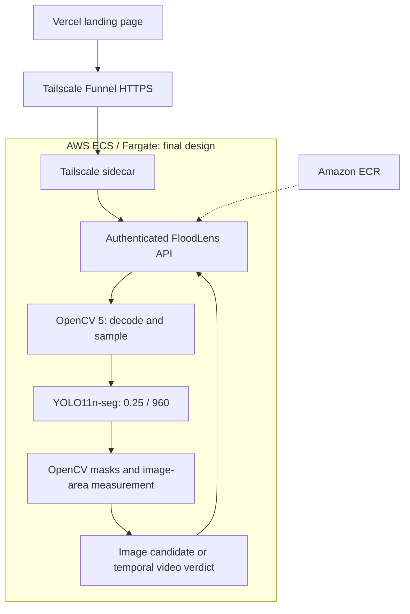

# FloodLens AI — Technical Report (Submission Draft)

**Project:** FloodLens AI — Experimental Visual Monitoring of Urban Flooding

**Competition:** OpenCV AI Competition 2026, powered by AWS

**Author:** Joao Lucas, Computer Science, Federal University of Cariri (UFCA)

**Status:** Final editorial candidate, 2026-10-18; awaiting owner approval and release checks. Not submitted. Availability and AWS origin are unverified in this review.

**Repository:** https://github.com/joa0lucassi/floodlens-ai

## 1. Abstract

FloodLens AI is a research prototype for identifying visually flooded regions in urban road scenes using real-world images and videos. It combines OpenCV 5 for frame acquisition and image-mask processing, YOLO11 instance segmentation, a temporal confirmation mechanism, an experimental heuristic risk score, and a FastAPI interface. The prototype is packaged with Docker. An earlier AWS ECS/Fargate test used optional S3 storage. The final judge-access design connects a Vercel landing page through Tailscale Funnel HTTPS to the AWS-hosted API; the authenticated review configuration disables S3 and shared server history.

On a frozen, independent 20-video evaluation set (10 flooded and 10 non-flooded videos), the evaluated pipeline identified all 10 flooded videos but also produced 5 false alerts in the negative group. Its video-level accuracy was 75%, recall 100%, precision 66.67%, specificity 50%, and F1 score 80%. These exploratory results show high sensitivity on that small sample and a clear remaining limitation: wet roads, rain and nighttime reflections can resemble actual flooding.

This system is **not an operational emergency alert service**. It does not measure physical water depth or provide calibrated probabilities of danger.

## 2. Problem, Users, and Potential Impact

Urban flooding can obstruct transportation, damage property, and expose people to hazards. Manual monitoring of numerous roads and intersections is difficult, while cameras that already observe public roads can provide potentially useful visual evidence.

Potential future users include municipal monitoring teams, researchers, road operators and emergency-management analysts. In its current state FloodLens is a research and demonstration tool. Before field deployment it would need larger representative evaluations, camera-specific calibration, privacy review, operational alert validation and human oversight.

## 3. System Architecture

The final judge-access design is **Vercel landing page → Tailscale Funnel HTTPS → AWS ECS/Fargate → FloodLens API**. The landing page navigates the browser to the demo; video uploads do not pass through Vercel. The planned AWS task hosts Tailscale beside the API. This design must be reconciled with actual deployed evidence before it is labeled operational.

The authenticated review configuration disables S3 persistence and shared history/risk endpoints. Browser-session metadata remains available. S3 is part of a separate optional mode and historical AWS validation. The [full architecture](submission_architecture.md) maps evidence and implementation. For video, the dashboard preview is one representative sampled frame, not a fully annotated video.

On 2026-10-18, the landing page returned HTTP 200 and the demo returned HTTP 502 from the review environment. This check does not identify the failure cause or establish whether the hostname currently reaches AWS or a local runtime. No infrastructure change or authenticated inference was performed.

## 4. Substantive OpenCV 5 Usage

The project uses OpenCV in the computer vision pipeline, including:
- `cv2.VideoCapture` to decode video and select frames from temporal positions;
- `cv2.imdecode` to decode uploaded still images;
- `cv2.fillPoly` and `cv2.countNonZero` to rasterize segmentation polygons and calculate their visual area in the image.

OpenCV works with YOLO segmentation predictions; it is not claimed that OpenCV itself is the learned segmentation model.

## 5. Model and Temporal Method

- **Official selected model:** YOLO11n-seg MultiDomain checkpoint. The experimental V3 hard-negative checkpoint was not promoted.
- **Inference confidence:** 0.25.
- **Inference size:** 960 px.
- **Video sampling:** approximately one frame per second.
- **Temporal confirmation:** sliding window of five sampled frames, requiring at least three frames with a model flood detection; a video is considered confirmed if at least one complete window satisfies this rule.
- **Insufficient data:** videos without five usable samples do not receive a definitive video-level classification.

**Visual flooded area** is the percentage of pixels in the image covered by the union of segmentation masks. It is sensitive to camera viewpoint and framing and **must not be interpreted as water depth in centimeters**.

The **risk engine** heuristically combines average visual segmented area, area trend and model confidence. Its labels (LOW, MODERATE, HIGH, CRITICAL) are not validated emergency severity or calibrated probabilities. Risk assessment is suppressed when the temporal window does not confirm flooding.

## 6. Experimental Data and Model Development

The research used real-image sources such as RuaLivreIA and UFES-derived segmentation samples (Deepflood, Sazara, WebCOOS) in training or validation, with separate development and frozen final evaluation materials. The `Deepflood.zip`, `Sazara.zip` and `WebCOOS.zip` training/validation package is traceable to **Wang, Y. (2024), *Urban Flood Image Dataset*, HydroShare**, whose resource metadata declares **CC BY 4.0** (https://www.hydroshare.org/resource/24866122a6ee456c8f7c80aa87a9abcb/). Credit this resource and the original dataset researchers. The exact rights of individual source images and the 21 separately collected hard-negative images require further review. See `docs/data_provenance_and_model_release.md`.

The V3 research stage assembled 108 visually reviewed hard-negative BDD100K images: rainy-day (40), nighttime (28), and rainy-night (40). The set contained 108 images paired with empty YOLO annotation files, representing scenes annotated as not flooded. This was a training experiment; it is **not** the independent evaluation set.

On the 20-image development regression set at 960 px and confidence 0.25, MultiDomain and the V3 model both achieved:

| TP | TN | FP | FN | Accuracy | Precision | Recall | F1 |
|---:|---:|---:|---:|---:|---:|---:|---:|
| 9 | 6 | 4 | 1 | 75.00% | 69.23% | 90.00% | 78.26% |

The V3 model corrected one false positive and introduced another; therefore, it showed no net classification benefit and was not selected. **Do not infer improved robustness from adding negatives alone.** Before distributing or using V3-derived weights in competition materials, review dataset licensing and submission rights; the official deployed model is MultiDomain, not V3.

## 7. Independent Final Holdout V2

The independent video evaluation was prepared and the evaluation configuration was frozen before its one-time run.

- 20 real videos: 10 flooded, 10 negative;
- 960 px full-frame inference; confidence 0.25;
- one sample per second;
- 5-sample sliding window, 3 required positives;
- a video positive when at least one window is confirmed.

| Metric | Result |
|---|---:|
| True positives | 10 |
| True negatives | 5 |
| False positives | 5 |
| False negatives | 0 |
| Accuracy | 75.00% |
| Precision | 66.67% |
| Recall | 100.00% |
| Specificity | 50.00% |
| F1-score | 80.00% |

This evaluation is small: a recall value of 100% here does not prove universal detection performance. Five negative videos were incorrectly confirmed as floods; difficult conditions included reflective pavement, rain without actual flooding, and nighttime lighting. Temporal filtering reduces isolated false detections but not persistent semantic misclassification.

The frozen holdout was not used for post-evaluation threshold selection, and it was not rerun during the subsequent API integration. Further details: `docs/final_holdout_v2_results.md`.

## 8. Implementation and AWS Delivery

The application exposes:
- `GET /` — browser dashboard;
- `GET /health` — health and S3 availability;
- `GET /risk/latest` — locally generated, separate risk-assessment artifact (not automatically updated by each upload);
- `GET /analyses/history` — S3-backed history, available only when enabled;
- `POST /analyze/image` and `POST /analyze/video` — analysis endpoints.

The deployment was validated using a Docker image with CPU-based inference, Amazon ECR for image distribution, ECS/Fargate for running the service, and S3 for optional media and analysis JSON storage.

On 2026-10-13, the AWS deployment reached an ECS stable state, returned a healthy `/health` response with the model loaded and S3 enabled, then processed a development flood video. The AWS response included 7 samples, 3 confirmed windows, first temporal confirmation at 4 seconds, risk MODERATE, and `storage.saved=true`. The task service was subsequently scaled down and observed at Desired=0, Running=0, Pending=0.

This is an end-to-end **functional smoke test**, not evidence of production uptime, latency guarantees, scale or safety. The historical test service was stopped afterward to limit compute charges; current task state was not inspected in this review.

See `docs/aws_end_to_end_validation_2026-10-13.md` for the verified cloud test details.

## 9. Reproducibility

**Reviewed source:** PR #4, commit `24ea9a86cf300c1f268ccc82ef0b98d9f15a8f77`; main does not include its demo safeguards. Reproduce this commit for application verification. No application code changes are part of this proposal.

**Requirements:** Python compatible with the pinned runtime, OpenCV 5, Ultralytics, PyTorch CPU, FastAPI and Docker. Direct production Python dependencies are pinned in `requirements-prod.txt`, including OpenCV 5.0.0.93; CPU PyTorch is pinned in `Dockerfile`. The Python base image tag, apt packages, transitive dependencies and Chart.js CDN are not fully locked. Current files are not a complete immutable dependency lock.

The trained model weight file is not versioned on GitHub. To reproduce inference, an authorized copy of the official MultiDomain checkpoint must be placed at:

    models/flood_segmentation/best.pt

From the repository root, with dependencies installed:

    python -m uvicorn src.api.main:app --host 127.0.0.1 --port 8000

Local health check:

    curl http://127.0.0.1:8000/health

Example video test (development video not included in the repository):

    curl -F "file=@data/flood_sample.mp4;type=video/mp4" http://127.0.0.1:8000/analyze/video

Docker:

    docker build -t floodlens-api:final .
    docker run --rm -p 127.0.0.1:8001:8000 floodlens-api:final

**Local clean-clone verification (2026-10-15): PASS.** The developer cloned the public `main` into a fresh temporary directory, separately copied the official `best.pt`, verified its SHA-256 with `scripts/verify_official_model.py`, built the Docker image, and launched the app on localhost port 8002. The returned health status was `healthy`, `model_loaded=true`, `s3_enabled=false`, version `0.7.0`. The developer subsequently confirmed successful completion of a real video analysis in the new instance. Detailed fresh-run metrics were not captured, and this test was not another independent evaluation. See `docs/clean_clone_smoke_test.md`.

A source-only clone cannot execute inference without the separately held official checkpoint. Controlled judge execution can avoid publishing weights, but does not resolve training-data/model permissions. Document the authorized reproduction or execution route explicitly; public weight release is not asserted as a competition requirement.

## 10. Responsible Use and Security Limitations

- False positives are significant, especially under glare, wet roads and nighttime reflections.
- The sample of independent videos is too small to generalize performance to all cities or cameras.
- Flooded image area is not physical depth. The risk label is an uncalibrated heuristic.
- Camera streams can contain identifiable people, vehicles or license plates; rights, minimization, privacy and retention policies are required for real operation.
- The reviewed implementation has no hard mechanism to terminate a stuck native decoder/inference call; its 180-second video budget is cooperative. This remains a deployment limitation.
- The current prototype should not be publicly exposed as a general-purpose, unauthenticated media-upload service without authentication, file size limits, rate limiting and hardened operational controls.
- Published competition materials must not expose AWS credentials, account identifiers, public task IPs or sensitive S3 information.
- The official model weights and any submitted media must have their distribution rights and attribution checked.

## 11. Roadmap

A future version may improve difficult negative discrimination through larger diverse training material, model verification and new independent evaluation. Another proposed direction is **FloodLens Hybrid**, combining fixed-camera visual extent, calibrated physical water-level sensors, and weather signals. These capabilities are proposals, **not** features claimed to be implemented.

## 12. Release and Submission Status

The written material is prepared for owner approval. The final video and screenshots, event-specific form verification, rights review, judge availability and final AWS origin evidence remain open. See [release checklist](submission_final_checklist.md), [official requirements](competition_requirements_2026-10-18.md), [Devpost copy](submission_devpost_draft.md) and [screenshot plan](submission_screenshots_checklist.md).

Do not publish demo credentials. Do not claim continuous uptime, unrestricted model distribution, calibrated emergency risk or live camera ingestion. Approval of documentation is separate from deployment, merge and submission.

## Sources in this repository

- `README.md`
- `docs/final_holdout_v2_results.md`
- `docs/aws_end_to_end_validation_2026-10-13.md`
- `src/evaluation/final_holdout_v2_evaluator.py`
- `src/evaluation/compare_multidomain_v3.py`

**Competition requirements:** https://opencv26.devpost.com/ (consult the current official rules and submission form).
