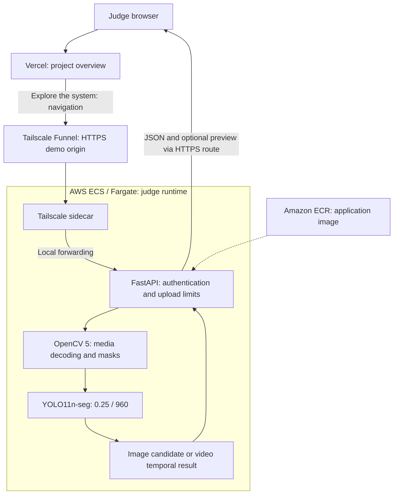

# FloodLens AI — Submission Architecture

Revision: 2026-10-18. The topology below was validated end-to-end on 2026-10-17 and then intentionally scaled down to stop continuous Fargate credit consumption. It is not a claim of continuous uptime; the final judge window must be revalidated after reactivation.

## Access and deployment

**Vercel landing page → Tailscale Funnel HTTPS → AWS ECS/Fargate → FloodLens API**.

Vercel does not run inference or proxy uploads. After navigation, the browser communicates with the separate demo origin. No public credentials are included. During the 2026-10-17 validation, Tailscale and the API ran in the same ECS/Fargate task, Funnel provided the public HTTPS entry point, Basic Auth was required, and real model inference completed successfully from an external session.

The validated application image was pinned to ECR digest `sha256:74eba2477e09342edb873ba4f5e879df05e9399dc33267834598d70e17d72fa2` in task definition `floodlens-task:5`. Judge and Tailscale credentials were supplied through AWS SSM SecureString parameters rather than source or public environment values. The API trusted only the local proxy through `FORWARDED_ALLOW_IPS=127.0.0.1`, and the public TCP 8000 ingress rule was removed while Funnel access continued to work.

After validation, the ECS service was intentionally scaled to Desired=0, Running=0, Pending=0. Therefore an automated HTTP check while the service is stopped may fail even though the architecture was previously validated.

## Analysis behavior

OpenCV decodes the input before inference. Images receive one visual prediction. Videos are sampled at approximately one frame per second; each sampled frame is passed to the frozen model. Segmentation polygons become a union mask for image-area measurement. Overlapping five-sample windows require at least three positive samples. Any positive complete window produces `CONFIRMED`; no positive window produces `NOT_CONFIRMED`; fewer than five usable samples produces `INSUFFICIENT_DATA`.

The video preview is one representative sampled frame with the largest predicted area. Its cyan overlay explains a prediction; it is not ground truth or a fully annotated video. Experimental risk is assessed only when temporally confirmed. Neither area nor risk measures physical depth or operational danger.

## Storage and evidence boundaries

Authenticated PR #4 mode disables S3 and shared history/risk endpoints. The dashboard keeps session metadata. Uploaded video is processed through a temporary file with cleanup in the application's `finally` path; this is not a blanket guarantee about browser, tunnel, host or logging retention.

| Evidence | What it establishes |
| --- | --- |
| October 13 AWS test | Earlier ECR/ECS/Fargate inference and optional S3 integration worked in a smoke test |
| PR #4 runtime commit `24ea9a8` | Reviewed source includes authentication, upload limits and S3-disabled demo logic |
| October 17 AWS/Tailscale validation | `floodlens-task:5`, pinned application digest, SSM secret injection, Funnel HTTPS, Basic Auth and real inference worked together on AWS |
| October 17 network validation | General inbound TCP 8000 was removed and Funnel continued to provide access |
| October 17 Vercel validation | Production landing page linked **Explore the system** to the final judge URL |
| October 17 shutdown | ECS reached Desired=0, Running=0, Pending=0 after validation to stop continuous task usage |
| October 18 automated link check | Landing 200; demo 502 while the backend was intentionally stopped; this is not evidence that the validated architecture was never deployed |

Implementation: `src/api/main.py`, `src/api/demo_security.py`, `src/vision/inference.py`, `src/vision/video_inference.py`, `src/storage/s3_storage.py`, `src/web/index.html`. See [access evidence](judge_access_plan.md) and [historical AWS test](aws_end_to_end_validation_2026-10-13.md).

## Release checks before judging

Because Tailscale state in the ECS task is ephemeral, a complete task replacement can create a hostname collision or suffix. Before the judge window, reactivate the service with separate owner authorization, confirm the expected Tailscale hostname, verify external authentication and one real inference, and confirm TCP 8000 remains non-public. Keep the service active only for the approved availability window and scale it down afterward.

The application also lacks a hard mechanism to terminate a native decoder or inference call that becomes stuck. The cooperative video budget is documented as a residual limitation rather than a hard execution guarantee.
