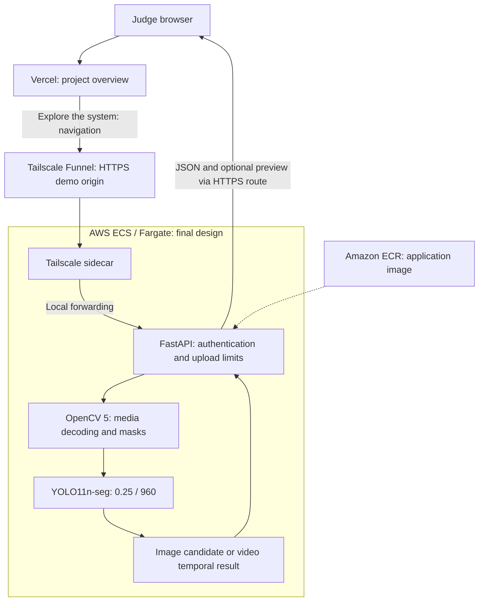

# FloodLens AI — Submission Architecture

Revision: 2026-10-18; proposal for owner approval. The final topology below is requested by the owner. Its deployed AWS origin and Tailscale sidecar configuration remain unverified. The HTTPS endpoint returned 502 during this review; do not label the diagram as a successfully observed deployment.

## Access and deployment

**Vercel landing page → Tailscale Funnel HTTPS → AWS ECS/Fargate → FloodLens API**.

Vercel does not run inference or proxy uploads. After navigation, the browser communicates with the demo origin. No public credentials are included. A stable name alone does not establish node identity persistence or prove the backend is AWS.

## Analysis behavior

OpenCV decodes the input before inference. Images receive one visual prediction. Videos are sampled at approximately one frame per second; each sampled frame is passed to the frozen model. Segmentation polygons become a union mask for image-area measurement. Overlapping five-sample windows require at least three positive samples. Any positive complete window produces `CONFIRMED`; no positive window produces `NOT_CONFIRMED`; fewer than five usable samples produces `INSUFFICIENT_DATA`.

The video preview is one representative sampled frame with the largest predicted area. Its cyan overlay explains a prediction; it is not ground truth or a fully annotated video. Experimental risk is assessed only when temporally confirmed. Neither area nor risk measures physical depth or operational danger.

## Storage and evidence boundaries

Authenticated PR #4 mode disables S3 and shared history/risk endpoints. The dashboard keeps session metadata. Uploaded video is processed through a temporary file with cleanup in the application's `finally` path; this is not a blanket guarantee about browser, tunnel, host or logging retention.

| Evidence | What it establishes |
| --- | --- |
| October 13 AWS test | Earlier ECR/ECS/Fargate inference and optional S3 integration worked in a smoke test |
| PR #4 at `24ea9a8` | Reviewed source includes authentication, upload limits and S3-disabled demo logic |
| Owner's earlier local test | Funnel HTTPS and authentication were reported working locally |
| October 18 link check | Landing 200; demo 502; current AWS origin and end-to-end execution unverified |

Implementation: `src/api/main.py`, `src/api/demo_security.py`, `src/vision/inference.py`, `src/vision/video_inference.py`, `src/storage/s3_storage.py`, `src/web/index.html`. See [access evidence](judge_access_plan.md) and [historical AWS test](aws_end_to_end_validation_2026-10-13.md).

Export the approved diagram for the final report/gallery after verifying that it matches the actual deployment. No task definition or infrastructure is created by this proposal.
