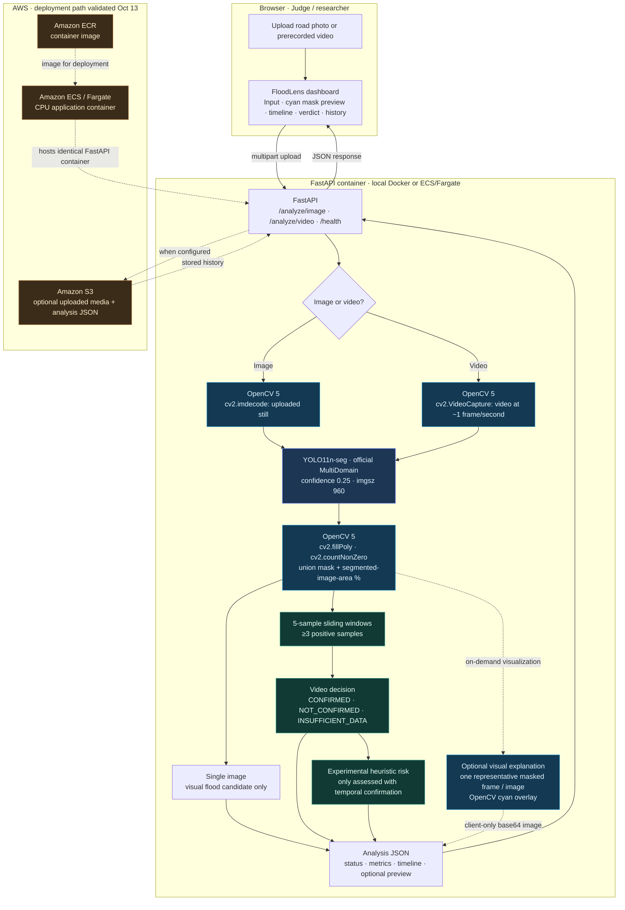

# FloodLens AI — Submission Architecture (October 2026)

This diagram describes the **implemented research prototype** and the AWS path that was **functionally tested on 2026-10-13**. The ECS service was intentionally scaled to **zero running tasks after validation**. Dashed lines indicate optional elements; no continuously running camera feed or automatic emergency alert is implemented.

## What the diagram must not imply

- **Not continuous CCTV:** input is user-uploaded prerecorded media.
- **Not a depth sensor:** segmented-area percentage is camera-view dependent, not centimeters of water.
- **Not verified disaster response:** video `CONFIRMED` means the temporal rule was satisfied, not independent verification.
- **Not a continually available AWS website:** the deployment test was successful, but ECS was scaled to zero after testing.
- **Not a fully annotated video:** the returned visualization is one representative masked video frame (or still-image overlay), generated on demand.
- **Not stored previews:** base64 preview data is intentionally excluded from S3 result metadata.
- **No COOL / autonomous agent:** this is a standard OpenCV 5 + YOLO computer-vision pipeline, not the optional special-prize implementation.

## Evidence and implementation map

| Component | Implementation or evidence |
| --- | --- |
| Upload endpoints | `src/api/main.py` |
| Image decoding / mask / visualization | `src/vision/inference.py` |
| Video decoding, temporal windows, frame sampling | `src/vision/video_inference.py` |
| Risk computation | `src/risk/risk_engine.py` |
| S3 results storage | `src/storage/s3_storage.py` |
| Interactive web dashboard | `src/web/index.html` |
| AWS validation | `docs/aws_end_to_end_validation_2026-10-13.md` |
| Independent evaluation | `docs/final_holdout_v2_results.md` |
| Clean clone verification | `docs/clean_clone_smoke_test.md` |

**Submission note:** Embed this diagram in the technical report and, if the Devpost form expects an image upload, export the Mermaid to PNG or SVG without changing its meaning.

## Judge-demo review update — 2026-10-15

The separate security review branch adds guarded uploads, admission limits, HTTPS-required configuration, non-root container execution, and ephemeral judge sessions (S3 and shared history disabled). The official checkpoint, inference parameters and frozen evaluation remain unchanged. See [review evidence](judge_security_review_2026-10-15.md), [access/cost/shutdown plan](judge_access_plan.md), and [video script](video_script_en.md). Local model-free tests are not real-model or cloud validation. No HTTPS endpoint has been deployed during this review; earlier local/AWS passes do not validate the new branch. Weight distribution remains restricted pending rights review.
